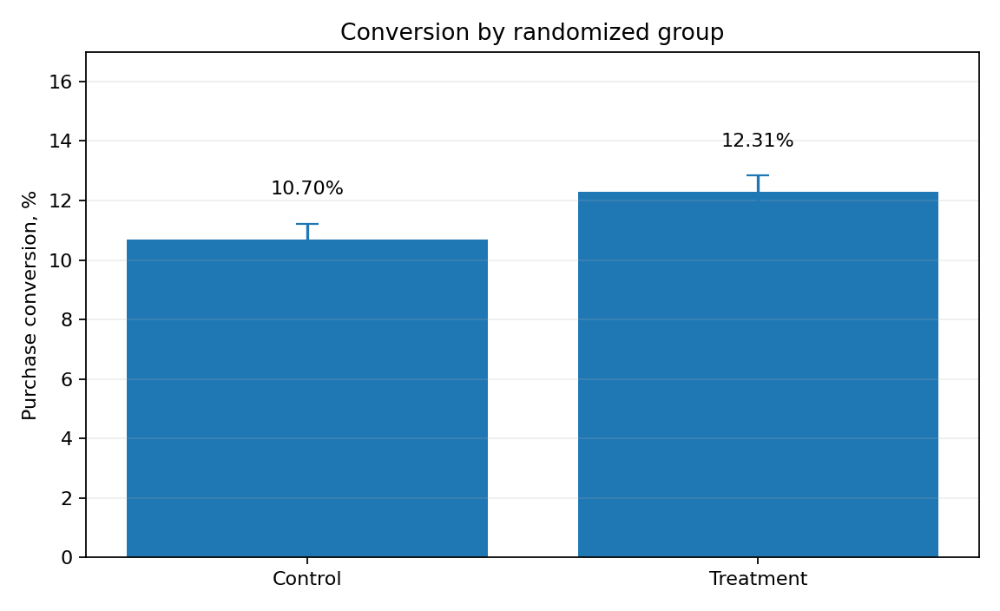
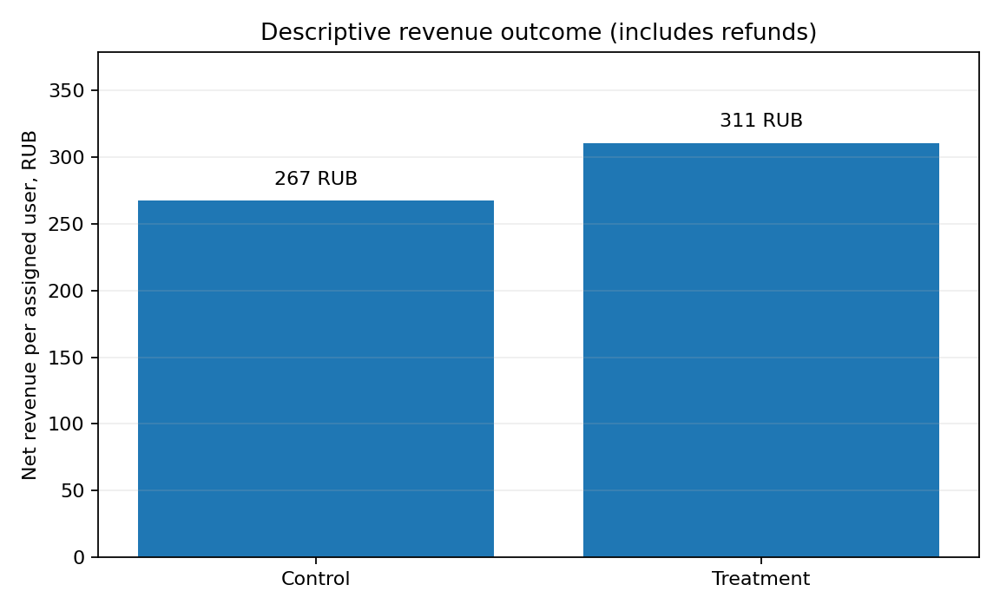

# A/B Test: Improving E-commerce Checkout Conversion

**Portfolio case study · Product Analytics · Python · SQL · Experimentation**

> **Synthetic data / синтетические данные.** All 30,000 user records and transactions are generated, not obtained from a real store. This repository demonstrates the analytical process rather than claiming real business impact.

## Business question / Бизнес-задача

Предположим, что команда интернет-магазина хочет упростить оформление заказа: сократить число шагов, чтобы больше пользователей завершали покупку. **Повысила ли тестовая версия конверсию?** И нет ли тревожных сигналов в возвратах и выручке?

- **Control (A):** старый интерфейс оформления заказа.
- **Treatment (B):** упрощённое оформление заказа.
- **Unit:** уникальный пользователь, начавший оформление; одна запись на пользователя.
- **Primary KPI:** purchase conversion = purchases / assigned users.
- **Secondary:** net revenue / assigned user.
- **Guardrail:** refunds / purchases (описательный анализ, без доказательства non-inferiority).
- **Experiment duration:** 28 days; 1:1 assignment; fictitious September 2026 data.
- **Statistical method:** two-sided two-proportion z-test, 95% Newcombe confidence interval, SRM chi-square check.

## Results / Результаты

См. [автоматически рассчитанные результаты](reports/findings.md) и [метрики в JSON](reports/metrics.json). Графики:





Рекомендация **в рамках симуляции**: обсуждать постепенный запуск при статистически значимом улучшении основной метрики и параллельно контролировать возвраты и экономику. Эти результаты нельзя выдавать за эффект в реальной компании.

## Repository structure

```text
checkout-ab-test/
├── README.md
├── requirements.txt
├── data/
│   └── checkout_experiment_synthetic.csv   # 30k simulated user-level events
├── scripts/
│   └── generate_data.py                   # reproducible data generator
├── src/
│   └── analysis.py                        # metrics, checks, statistical tests, plots
├── sql/
│   └── metrics.sql                        # SQLite aggregate and segment queries
├── notebooks/
│   └── ab_test_walkthrough.ipynb          # annotated step-by-step notebook
├── figures/                               # generated plots
├── reports/                               # computed results and recommendation
├── tests/                                 # basic data/metrics checks
```

## Reproduction (Python 3.10+)

From the repository's top-level folder:

```bash
python -m pip install -r requirements.txt
python scripts/generate_data.py
python -m src.analysis
python -m pytest -q
```

Открой `notebooks/ab_test_walkthrough.ipynb` в JupyterLab (`jupyter lab`) или в VS Code. Из репозитория доступен и уже сгенерированный CSV, поэтому для чтения результатов установка Python не требуется.

## Key analytical decisions

1. **Intent-to-treat:** in the denominator are all assigned users, not just the buyers.
2. **Single primary metric:** conversion is tested at alpha 0.05; secondary metrics are exploratory.
3. **SRM check:** unexpectedly unequal assignment can undermine experiment validity.
4. **Absolute vs relative lift:** percentage points and percent lift are different quantities.
5. **Guardrails & limitations:** a small refund difference cannot prove absence of harm.


**No actual user/customer records, employer claims, personal credentials, or production access are included.**
